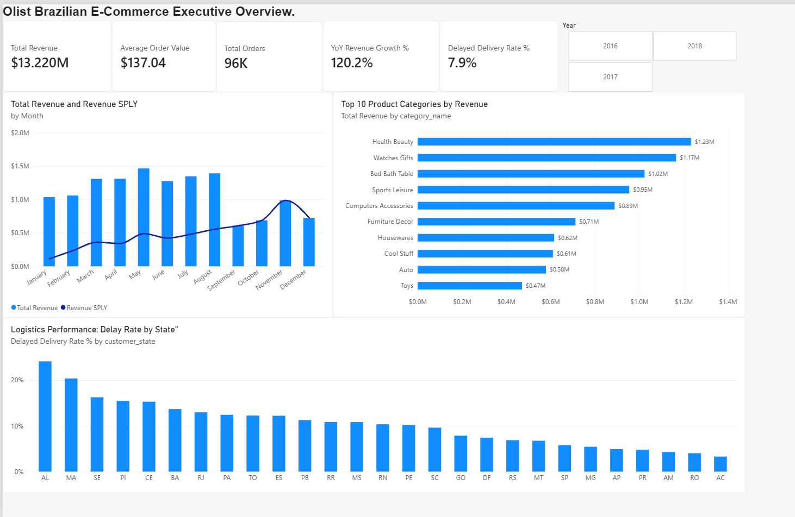

# Olist Brazilian E-Commerce Analytics Platform
*An End-to-End Business Intelligence and Relational Data Modeling Project*



## Executive Summary
This project delivers an enterprise-grade analytics solution analyzing over 100,000 orders from the Brazilian e-commerce platform Olist. By building an upstream relational data warehouse in PostgreSQL and an optimized Star Schema in Power BI, this platform tracks revenue growth trajectories, category performance, and critical logistics delivery bottlenecks across Brazilian states.

## Architecture & Data Pipeline
1. **Database Layer (PostgreSQL):**
   - Ingested raw transactional, product, customer, and translation CSV datasets.
   - Built optimized SQL views (`view_fact_sales`, `view_dim_customer`, `view_dim_product`) to handle data cleansing, typecasting, categorical translations, lead time calculations, and delivery delay flags at the database layer.
2. **Semantic Modeling Layer (Power BI):**
   - Engineered an analytical Star Schema with 1-to-many single-direction relationships filtering into the core fact table.
   - Created a continuous DAX calendar dimension (`Dim_Date`) marked as an official Date table to power accurate time intelligence.
3. **Analytics & DAX Layer:**
   - Implemented dynamic business logic including Total Revenue, Average Order Value (AOV), Same-Period-Last-Year (SPLY) revenue, and Year-over-Year (YoY) growth percentages.
   - Designed an operational delivery delay KPI evaluating on-time shipping adherence across regional territories.
### Dataset Access
The underlying raw transactional dataset is provided by Olist on Kaggle:
- [Download Brazilian E-Commerce Dataset on Kaggle](https://www.kaggle.com/datasets/olistbr/brazilian-ecommerce?resource=download)

## Core Data Model
- **Fact Table:** `view_fact_sales` (Grain: 1 row per order item)
- **Dimension Tables:**
  - `Dim_Date` (Calendar hierarchy and sorting indexes)
  - `view_dim_customer` (Customer unique IDs, cities, and states)
  - `view_dim_product` (Product IDs and English category mappings)

## Key DAX Formulations
- **Same Period Last Year Revenue:**
  ```dax
  Revenue SPLY = 
  CALCULATE(
      [Total Revenue],
      SAMEPERIODLASTYEAR('Dim_Date'[Date])
  )
